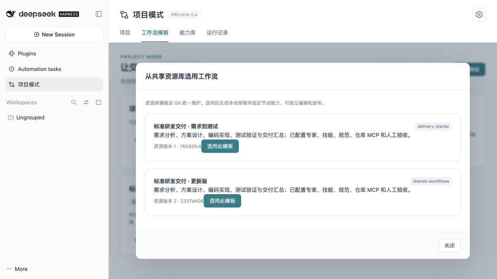
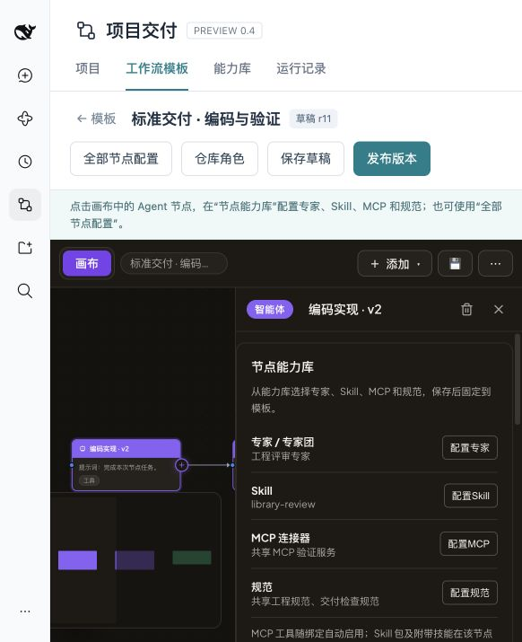

# DSH 项目模式

在 DSH 中创建业务项目，绑定一个或多个 Git 仓库，选用可复用 DAG 模板，并跟踪每次运行的进度、节点产物和质量验收。

当前分支为 **0.4.0-preview.11 产品预览版**，目标宿主是 **DSH 0.2.1-rc2（npm 0.2.1-rc.2）**。本分支未发布到 npm 或 GitHub Release；不要使用旧 0.3.1 的下载命令获取这个预览版。

运行面板现已支持节点对话、模型返回的思考和工具过程；用法及交互与验收的关系见 [节点对话与运行过程](docs/node-dialogue.md)。

## 产品入口

DSH 侧栏 → **项目模式**，包含四个页面，右上角齿轮管理设置和共享资源库：

- **项目**：管理仓库别名、本机 Git 根目录和分支；选用已发布的工作流版本，映射仓库角色，输入业务需求并发起运行。
- **工作流模板**：创建和编辑任意 DAG 结构；配置节点任务、模型、仓库角色、入口专家/专家团包、Skills、MCP、规范及人工验收；保存草稿、发布版本、复制、导入导出、重命名和归档。
- **能力库**：直接展示本地、项目与共享能力，显式选择并固定节点所用内容。共享 Git 资源库在右上角齿轮设置中管理。
- **运行记录**：查看 DAG 进度、模型与仓库快照、节点输出、文件产物、验收轮次、恢复入口和累计代码补丁。



已有的设置页“会话项目”和 `/project` 命令保留，继续用于普通 DSH 会话 preset。业务交付项目从新侧栏入口管理。

## Windows 封闭环境验证

完整步骤见 **[Windows 安装与验证](docs/windows-preview.md)**。准备机可以是 Windows、macOS 或 Linux，不需要在 Mac 上安装 Windows 原生依赖。

在可联网的准备机，从当前分支制作离线包：

```sh
npm ci --ignore-scripts --legacy-peer-deps
npm run build:client
npm run prepare:offline
```

将 `dist/` 下的 `.tgz`、`.sha256`、`install-windows.ps1` 和 `WINDOWS-README.md` 复制到目标机。目标机已有 Node.js >=22.15、Git for Windows 和 DSH 0.2.1-rc.2 后，关闭 DSH，在 PowerShell 安装：

```powershell
powershell -ExecutionPolicy Bypass -File .\install-windows.ps1 `
  -Archive .\dsh-workbuddy-project-0.4.0-preview.11-offline.tgz `
  -Profile web -DshHome 'D:\dsh-validation' -DshRoot 'D:\tools\dsh'
$env:DSH_HOME = 'D:\dsh-validation'
dsh --profile web --no-open
```

插件安装本身不下载依赖；实际运行需要目标环境中可访问的模型服务，以及所选 MCP、Skill 和业务项目自己的工具链。建议先在单独的 `DSH_HOME` 中配置模型并确认普通会话可用，再验证项目模式。

## 内置标准研发模板

在 **工作流模板 → 从资源库选用** 创建“标准研发交付 · 需求到测试”。四个 Agent 已配好专用专家、Skill、通用与阶段规范，以及无需联网的本地仓库只读 MCP；每阶段默认人工验收。沿用 DSH 当前模型，项目只需把 `main` 角色映射到本机仓库即可运行。完整能力映射与功能验证见 [标准研发交付模板](docs/software-delivery-starter.md)。

## 第一次交付

1. 在能力库中准备所需的专家、Skill、MCP 和规范。也可以先不绑定能力包。
2. 新建工作流模板，在画布增删节点、建立依赖；点击 Agent 节点，在右侧“节点能力库”配置专家、Skill、MCP 和规范；“节点设置”中配置仓库角色和基础工具。需要人工检查的节点启用验收，再保存并发布 v1。
3. 手工 clone 业务仓库并提交初始内容，新建项目，填写本机仓库路径和 ref。
4. 为项目选择模板 v1，将仓库角色映射到项目仓库。
5. 输入本次需求并运行。需要验收的节点执行完成后等待，填写验收说明、通过后继续下游。
6. 查看产物，下载所选节点的累计补丁，在干净分支上 `git apply --check` 后应用。

基础工具只列出当前交付运行可用的 read、write、skill、bash；MCP 工具随连接器绑定自动提供，Skill 从能力库按节点加载。



“需求分析 → 设计 → 编码 → 测试”只是一个例子，模板不固定这几个阶段。发布版本、节点能力、运行模型和仓库提交均在运行开始时固定，后续修改不改变旧运行。

## 当前边界

这是第一版产品预览，仍需要 Windows 和实际模型环境的功能验收，详见 [验证记录](docs/product-preview-validation.md)。

- 当前业务执行支持 Agent、JavaScript、输入、输出节点；画布中的其他高级节点暂未接入交付运行。
- 专家团按一个包的入口加载，附带 Skill 一起提供；不在节点内再启动 Teams 多成员调度器。
- 完成条件先提供人工验收，hook、自动测试与产物校验提供方保留扩展空间。未配置验收只表示执行完成。
- 仓库先在本机准备。每个 Agent 有一个主仓库 cwd；多仓库项目通过节点角色分工。
- 运行使用私有 Git worktree，不自动改动源仓库、不自动 push；源仓库未提交内容不进入运行。
- MCP 按能力包绑定；宿主原生 MCP 需先保存为能力包。共享能力库不负责分发账号凭据。
- 本地独立运行、内网共享能力库；集中调度、多人审批、自动克隆仓库尚未提供。

## 能力库与内网分发

能力包格式见 [能力包约定](docs/capability-packages.md)，内网 Git 插件市场见 [内网发布指南](docs/intranet-market.md)。

原有会话项目使用 `<DSH_HOME>/projects`；业务交付数据默认在 `<DSH_HOME>/delivery`。可通过 `projectsRoot`、`deliveryRoot` 显式配置。配置 `libraries` 可添加预置能力库；界面中也可以添加 Git 资源库并同步。

共享库同步与工作流发布是两个动作。选用的能力包保存内容快照，旧模板版本和已有运行不随资源库同步而变化。

## 开发与打包

```sh
npm run build:client
npm test
npm run test:delivery
npm run check:package
npm run prepare:offline
```

真实宿主的旧能力管理测试使用 `WB_DSH_NODE_MODULES` 指向 DSH 的 `node_modules` 后运行 `npm run test:host`。产品离线安装与正常路径自动化见 [发布验证](docs/releasing.md)。测试用模型适配器只在 `test/`，不进入安装包，也不改变产品模型选择。

内嵌 Workflow One 0.12.0 调度器与画布，MIT 许可证和适配重现方法见 [第三方来源](lib/vendor/README.md)。不依赖另行安装 Workflow One 或 Teams 插件。

工作流模板可从 Git 共享资源库选用，标准研发模板与能力包在同一个资源目录中维护。参见 [共享资源库与工作流](docs/shared-workflows.md)。打开有运行任务的项目会定位当前节点；红色“重试＋节点名”需要确认从头执行，“接着完成＋节点名”保留原会话和已有成果。
