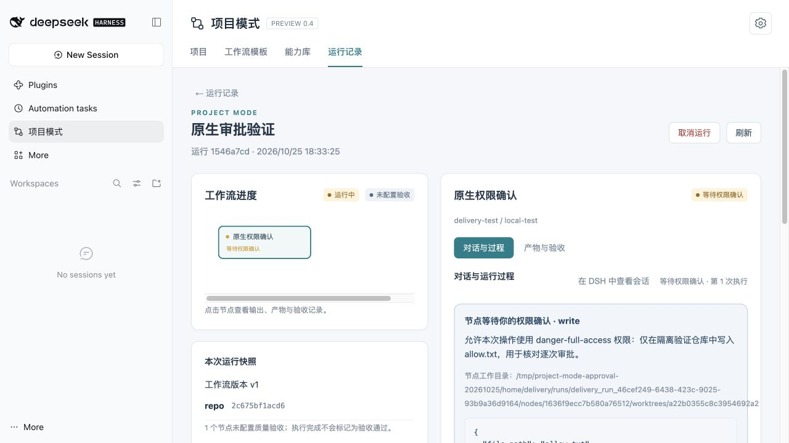
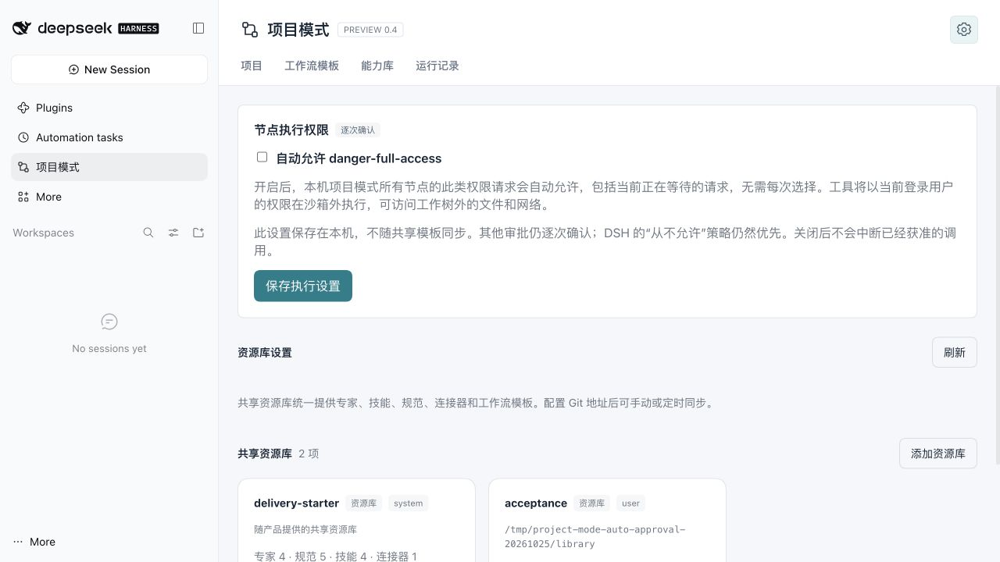

# 节点原生审批接入验证

日期：2026-10-25。项目模式 `0.4.0-preview.14`，真实 DSH `0.2.1-rc.3`，macOS / Node.js v25.6.1。使用从源码准备的隔离 `DSH_HOME` 与确定性测试模型，无外部模型调用；没有制作离线包，没有执行 Windows ACL 修复脚本。

修复背景：原项目页面没有承接 `approval/request`，节点的原生只读会话又会优先显示只读提示；同时，等待审批没有暂停节点总超时。`approval ... was cancelled` 只证明请求已撤回，不能仅凭这一条错误认定是谁取消或哪一个时限触发。

项目节点现在以 Agent 作用域中的原生审批回答者承接请求：DSH 原生审批服务先执行策略判断，仍负责生成 `approval/asked` 和 `approval/decided` 审计；项目模式只等待用户对具体工具调用作出“仅允许本次”或“拒绝”。没有永久放行或默认完全权限操作。

已验证：

- `npm run test:approval`：准确显示调用参数与工作目录；不同执行轮次、重复或撤回的请求不能放行；并行待审批状态独立；计时器在全部等待结束后才恢复；轮询保持按钮和焦点；显示页面不会自动批准。
- `check-approval-host.mjs`：真实原生 `write` 工具请求单次额外权限。节点总超时为 4 秒，每笔审批等待 5.5 秒，仍可继续决定；获准文件实际生成，拒绝的文件保持不存在。取消运行后待审批撤回，旧请求不能再次决定。源仓库保持干净，原生 Session 事件流记录两次询问及允许／拒绝结果。原生文件写入按调用顺序处理；嵌套等待另由引擎测试覆盖。
- 浏览器：项目节点显示“等待权限确认”、请求理由、工具参数、工作目录与两个决定按钮。逐次拒绝测试调用后显示已拒绝，审批卡撤下，节点继续处理原生工具结果。
- 既有包、Git 同步、Windows 映射路径、原生会话、人工提问、验收前返工、续跑和重试回归通过。

这份验证覆盖审批接入与等待生命周期。Windows `SetNamedSecurityInfoW (Win32 5)` 的具体权限原因仍须目标机诊断报告；获得审批只代表允许脚本运行，不代表目录权限修复成功。

## preview.15 自动允许配置验证

同日使用全新隔离 DSH_HOME，从 preview.15 源码安装到真实 DSH 0.2.1-rc.3，未制作离线包。

- 配置默认关闭，校验布尔值；保存到本地业务数据库，数据库关闭重开后仍保留。
- 保存开启立即放行当前等待的完全访问请求；下一次请求无需手动决定，两个原生 `write` 调用都实际生成各自的测试文件。节点显示设置来源，原生 Session 中保留两组 `approval/asked` / `approval/decided`，决定为 `allowed-once`。
- 保存关闭后，新运行重新出现待审批卡。其他权限及仅在命令文本中提到完全访问的调用不匹配自动允许逻辑。
- 设置页测试覆盖勾选草稿、显式保存、重新打开回显、保存失败和关闭；真实浏览器确认齿轮内展示开关与沙箱外执行范围，默认未勾选。
- 原有手动允许、拒绝、取消、等待计时和原生会话回归仍通过。原始源仓库保持干净，没有执行 Windows ACL 修复脚本。

