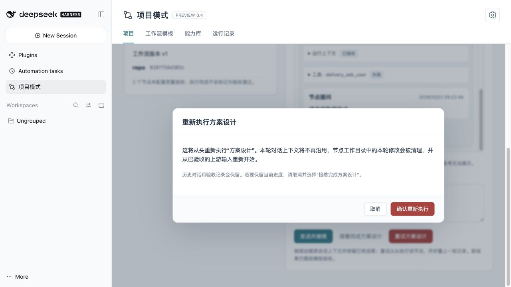
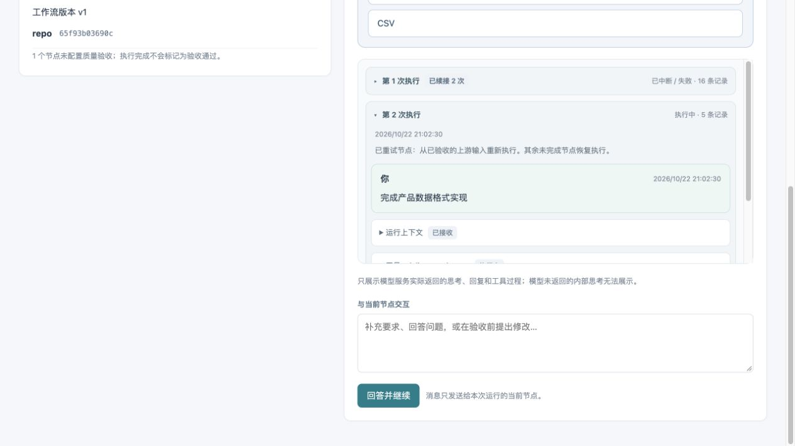

# 节点对话与运行过程

适用：DSH 0.2.1-rc2 / 项目模式 0.4.0-preview.11。打开“项目模式 → 运行记录”，点击 DAG 中的 Agent 节点。右侧有两个页签：

- **对话与过程**：实时回复、模型服务返回的思考、工具调用与结果、节点提问，以及消息输入。
- **产物与验收**：当前固定输出、代码文件、累计补丁和人工验收。

## 在不同状态下交互

| 状态 | 操作与实际效果 |
| --- | --- |
| 运行中 | 发送补充要求。DSH 在后续推理步骤接收，不会撤回已经执行的命令。消息显示提交/接收状态，重复请求不重复投递。 |
| 等待回答 | 节点通过 `delivery_ask_user` 提出问题；选建议或输入文字后点击“回答并继续”。答案返回该节点的原会话，等待人工的时间不计入节点执行超时。 |
| 待验收 | 点击“继续对话并重新验收”，可以讨论、补充要求或要求修改。沿用原会话、专家、能力、规则及运行工作树，生成下一次执行尝试；新输出与产物重新固定，形成新的验收对象。 |
| 中断 / 失败 / 取消 | 本轮运行结束后，点击“接着完成＋节点名称”，或输入要求点击“发送并继续”。通过 DSH 持久化加载原会话及工具记录，保留工作树成果继续；尚未固定输出的中断保留原执行次数。点击“重试＋节点名称”才清理节点残留修改，从上游输入重跑并进入下一次执行，自动折叠上一组对话。 |
| 已完成 | 点击“询问结果（只读）”。另建只读讨论会话，仅允许读取文件；写入、命令和委派操作由执行门禁拒绝，不会修改代码、固定输出、原验收或下游运行结果。需要修改已经交接的结果时，发起新运行。 |
| 非 Agent 节点 | 查看现有节点输出与产物，没有模型对话。 |

问答不等于质量验收，验收说明也不发送给模型。继续对话后必须检查新的产物并重新验收；旧检查对象及其决定保留，旧验收不能放行新结果。下游始终读取新近验收通过的固定代码快照。

## 思考与工具过程

“模型返回的思考”只来自模型服务实际发布的 reasoning 内容；可折叠查看，生成时显示前缀。模型没有返回时，仍显示实际回复与工具过程，不推测隐藏推理。工具卡可展开参数与结果，成功/失败来自宿主真实执行结果。

对话、流式展示记录及消息回执保存到该 DSH_HOME 的交付数据库。记录按运行、节点和执行次数分组；每组可折叠。默认收起旧组、展开当前组，重试时自动切到新组；继续当前执行追加在原组，显示续接次数。手动展开/折叠在页面自动刷新时保留。输入框内容和已展开卡片在页面自动刷新时保留。首次打开节点对话或重新进入页签时自动滚动到最新消息；向上翻阅后，自动更新保持阅读位置。提问选项采用左对齐卡片，选中后仍需点击“回答并继续”发送。展示接口最多返回最近 300 条记录及约 512 KB 内容，每条文本最多 64,000 字符；超出部分会提示省略。

过程可能包含业务输入、工具读取的文件和输出，按本机交付数据管理。服务不会把模型配置、MCP 连接凭据或提供方原始私有字段当作思考内容发送到面板。

## 升级与恢复

功能用于已有模板的新运行，不需要重建 DAG。升级不会补造旧运行没有采集的思考；旧节点有固定产物时可发起只读讨论。

历史记录可跨重启查看。检查点恢复仍遵守原有确定性规则，不把未固定结果当作已完成。完整检查点可直接“恢复运行”；失败、不确定或取消的执行由用户显式选择继续或重试。继续使用 DSH `agents.resume` 加载原持久化 session，恢复原始会话事件及工具结果，重新挂载冻结的模型、专家、Skill、MCP、规范和仓库映射，随后只发送新的继续要求，不重发初始任务，也不使用面板的截断历史代替模型上下文。模型请求仍遵守 DSH 的上下文窗口和压缩机制。缺少原 session 或恢复失败时明确报错，不静默新建会话或清理已有成果；用户可显式选择重试。缺少已准备的代码输入时只提供重试。

已成功且通过所配验收的节点复用固定输出；其它待验收节点继续停在原检查对象，失败或尚未执行的节点恢复调度。未固定输出的中断继续沿用本次执行编号，记录续接时间；若已有不可变检查点，继续修改会生成新输出尝试，原检查点和验收决定保持不变。旧验收不能放行新结果。运行仍有其它节点执行时，需等本轮结束后再操作。恢复到待验收的旧节点如果没有在线会话，可以先验收，或取消本轮后选择该节点继续/重试。已验收交接的节点只提供只读讨论，修改请发起新运行。

## 界面



截图来自隔离安装的确定性测试模型，用于验证产品交互，不代表实际业务模型效果。



## 验证

`npm run test:delivery` 包含节点交互账本测试。真实宿主验收：

```sh
node test/delivery/check-dialogue-host.mjs <isolated-installed-test-root>
node test/delivery/check-restart-host.mjs <isolated-installed-test-root>
# 重启恢复验证：先准备中断节点，停止并重新启动同一测试 DSH_HOME
node test/delivery/check-restart-host.mjs <isolated-installed-test-root> --prepare-resume
# 重启该隔离宿主后执行：
node test/delivery/check-cold-resume-host.mjs <isolated-installed-test-root>
```

准备隔离安装的步骤见 [发布验证](releasing.md)。验证模型只属于测试环境，不包含在产品安装包中；Windows 和实际模型服务仍需目标环境验证。
