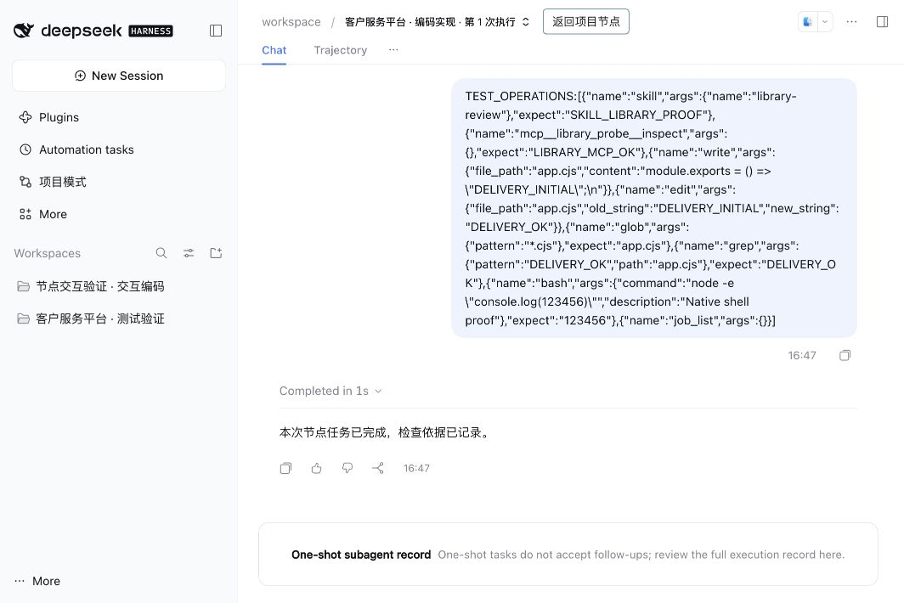

# rc3 原生工具与节点会话验证

日期：2026-10-24。项目模式 `0.4.0-preview.13` 源码，真实宿主 `@deepseek-ai/dsh@0.2.1-rc.3`，macOS，Node.js v25.6.1。

本次直接从源码准备独立 `DSH_HOME`，没有制作离线包。使用仅测试环境注册的确定性模型适配器，外部模型调用为 0；原生 Agent、Session、归档服务、工具、连接器、工作流调度、Git 工作树与质量记录均使用实际实现。

已通过：

- `npm test`：能力库与包解析、Git 同步、Windows 映射路径和本地模块 URL。
- `npm run test:ui`：原有页面交互回归。
- `npm run test:native`：Windows 命令授权兼容、原生工具授权范围、会话关联持久化、业务消息准入、旧节点归档和普通工作区保护、客户端跳转前刷新会话目录、来源 iframe 校验和返回节点导航。
- `check-installed-host.mjs`：真实 `edit/glob/grep/bash/job_list` 调用、技能与连接器加载、节点 Session 使用真实委派描述和父会话地址，不注册可见 Workspace、人工验收后才进入下游。
- `check-dialogue-host.mjs`：运行中补充消息、模型返回的思考流、人工提问、验收前返工和质量记录；返工沿用同一原生会话。
- `check-restart-host.mjs`：模型中断后续跑保留上下文和文件，重新执行清理本轮修改并创建新会话。
- 浏览器：节点入口打开原生会话，展示真实历史；原生入口只读；返回原运行和原节点；宿主重启后再次打开持久化会话。新节点不新增侧栏工作区；旧节点经原生归档收起、打开后可返回原节点并再次收起。

Windows 的 `pwsh` 选择与旧 `bash` 授权映射通过逻辑验证；未在 Windows 原生宿主执行。本轮未继续运行批量文件变更场景，留给手工验证。

复现方法见 [发布与开发验证](releasing.md)，入口和限制见 [节点对话](node-dialogue.md)。本轮原生会话提供查看和导航；节点写入交互、继续、重试和验收仍由项目模式管理，多个会话尚未并排展示。
