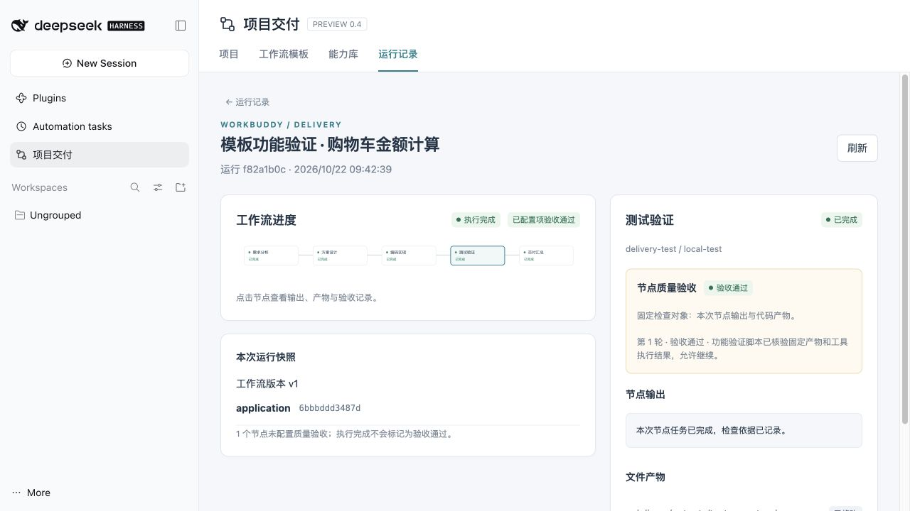

# 标准研发交付 · 需求到测试

DSH 0.2.1-rc2 / 项目模式 0.4.0-preview.15。

## 创建与使用

1. 进入 **项目模式 → 工作流模板 → 从资源库选用**，选择“标准研发交付 · 需求到测试”并点击“选用此模板”。它会生成可自由编辑的草稿，并固定每个节点的能力内容。
2. 草稿已经包含 `main` 仓库角色、节点提示词与上下游依赖、运行参数和四项人工验收。无需逐节点手工勾选能力。
3. 发布 v1，创建业务项目并绑定一到多个本机 Git 仓库；选用该模板，将 `main` 映射到本次要修改的仓库。此模板四个阶段共用该角色，多仓库分工可复制后自行调整。
4. DSH 先选择可用模型。发起运行时输入业务需求，可填写 `validationCommand`（如 `node --test`、`npm test` 或项目真实检查命令）及 `constraints`。留空验证命令时，由节点检查仓库脚本后选择。
5. 逐阶段查看固定产物并验收。验收通过才执行下游；失败后保留证据，处理问题并按当前产品的复核/重跑机制继续。
6. 测试验收后汇总结束，从测试节点下载累计补丁，在干净分支核验并应用。不会自动提交、推送或部署。

## 已配置的能力

| 节点 | 专家 | Skill | 规范 | MCP | 主报告 |
| --- | --- | --- | --- | --- | --- |
| 需求分析 | 业务需求分析师 | `delivery-requirements` | 研发交付通用规范 + 需求分析规范 | 本地仓库上下文（只读） | `requirements.md` |
| 方案设计 | 软件架构设计师 | `delivery-design` | 通用规范 + 方案设计规范 | 同上 | `design.md` |
| 编码实现 | 软件实现工程师 | `delivery-implement` | 通用规范 + 编码实现规范 | 同上 | `implementation.md` |
| 测试验证 | 独立测试工程师 | `delivery-verify` | 通用规范 + 测试验证规范 | 同上 | `test-report.md` |

报告路径均为运行仓库的 `.delivery/outputs/`。四阶段顺序为 **需求分析 → 方案设计 → 编码实现 → 测试验证 → 交付汇总**。每个 Agent 有独立会话、专家、能力快照和 Git worktree；上游验收后的文档与代码通过仓库交接传给下游，不能只靠聊天摘要。

需求阶段形成编号验收条件（AC）；设计给出接口与文件级计划、AC→模块→测试的映射；编码实现并自检；测试独立核对 AC、执行回归并记录命令、退出码、缺陷和未验证项。四阶段的“执行完成”都会进入人工验收；测试报告写“通过”本身不会自动放行。

这些是本插件随包维护的可审阅能力，位于 `examples/software-delivery/library`，资源库名为 `delivery-starter`。可以在能力库查看，也可以把整个目录放进内网 Git 能力库，替换成团队专家、技能和规范。模板配方为 `examples/software-delivery/library/workflows/software-delivery/workflow.json`，包含可移植引用；使用产品入口创建时才在本机解析并固定快照，配方文件不是包含能力缓存的普通模板导出包。

## 本地 MCP

`delivery_repo` 是无需第三方 npm 依赖的 stdio MCP，使用目标机现有 Node，提供：

- `workspace_summary`：只读列出本节点工作树中的文件，包含交接文档位置。
- `read_document`：读取当前工作树内不超过 64 KB 的文本/代码文件。

不访问网络，不执行命令，不写文件；跳过常见凭据文件、Git 元数据、node_modules 和符号链接。测试命令仍由 DSH 的 bash 工具执行并遵循宿主策略。连接器的 `WORKBUDDY_WORKSPACE` 使用 `${WORKBUDDY_NODE_CWD}`，在节点部署时解析为本次私有工作树，安装包不写入开发机绝对路径。该占位符目前仅由项目模式节点运行解析。

此模板不预绑需要组织地址和凭据的 GitLab、Jira、禅道等服务。需要这些集成时，可在对应节点附加团队能力库中的 MCP 包。模型仍需本机或内网可访问的服务。

## 功能验证

在 macOS / Node.js 25.6.1 / DSH 0.2.1-rc.2 的独立配置中，使用安装后的离线包，通过产品的同一个模板创建接口完成：

- 不修改模板图或提示词，创建、固定四类能力、发布 v1、绑定真实 Git 仓库。
- 四个独立 Agent 分别加载本阶段 Skill，接收对应专家和规范；本地 MCP 实际读取各自工作树和已交接的需求/设计/实现报告。
- 每阶段固定报告后暂停，下游在接受当前验收前不启动；验证脚本检查产物并提交验收决定，保留四项记录。
- 以购物车金额计算为样例，生成需求、设计、CommonJS 实现和独立测试报告；编码和测试 Agent 均通过真实 DSH bash 执行 7 项测试。
- 测试覆盖汇总、折扣取整、全额折扣、空购物车、非法输入及整数溢出。累计补丁在新 clone 应用后，再次执行：7 通过、0 失败。源仓库保持干净。

模型决策使用**仅在测试目录注册的确定性适配器**；没有把测试指令或假模型放入模板/安装包，没有调用外部模型。上述验证证明能力与运行链路及真实命令工作，不能证明实际业务模型的需求分析和编码质量。Windows、实际模型与团队业务仓库仍须目标环境验证。

本轮记录：[完整结果](validation/software-delivery.json)、[干净仓库复测输出](validation/software-delivery-tests.txt)。

重现：按 [发布验证](releasing.md) 准备隔离宿主后，运行 `node test/delivery/check-starter-host.mjs <root>`。完整执行记录保存在测试目录的 `starter-report.json`、`starter-test-output.txt` 和 DSH 会话中。
